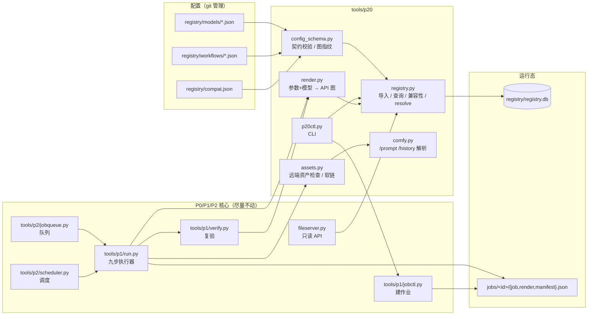

# P2.0 任务 3：Workflow Registry 与 Model Registry 技术设计

> 版本：v1.0 · 2026-11-01 · 对应代码 `tools/p20/`、配置 `registry/`
> 设计目标：**新增工作流/模型只改配置，不改 `run.py` / 调度器 / 队列**；同时保证「未验证的模型组合不许跑」「跑过的产物可追溯」「老作业不被破坏」。

---

## 1. 目标与非目标

### 1.1 目标

| # | 目标 | 可验证的判据 |
|---|---|---|
| G1 | 模型/节点/参数知识从执行器里搬出去 | `run.py` 不再出现具体模型文件名/节点类；新工作流只加 JSON |
| G2 | 一个参数可以映射到多个节点/输入 | h3 的 `width` 同时写 `cond.width` 和 `neg.width` |
| G3 | 模型文件与工作流解耦 | 同一工作流换 `models/*.json` 的 `files` 即换权重 |
| G4 | 未验证组合默认拒绝 | `h3_i2v_121f × h3` 是 `experimental`，`resolve` 直接报错 |
| G5 | 已验证组合有证据 | `compat verify` 要求证据作业 `DONE + manifest PASS + registry 元数据匹配` |
| G6 | 版本可追溯 | 作业记录 `workflow_version/model_version`，`render.json` 留实际提交图 |
| G7 | 派生库可重建 | 删 `registry/registry.db` 后 `p20ctl import` 完整恢复 |
| G8 | 对老系统零破坏 | `jobctl validate` / `cases.py` / `p2` 42 条单测全绿 |

### 1.2 非目标（本轮明确不做）

- **不做 UI 写操作**（提交/取消/重试仍走 CLI）。写 API 需要幂等令牌 + 审计 + 权限升级，留二期。
- **不做「一个实例跑多个 job」**。P2 的「一实例一 job」不变。
- **不替换 `queue.db`**。Registry 只管「配置/兼容性」，不管队列状态。
- **不做自动模型下载**。模型仍在 `/model` 共享库，Registry 只登记「文件名 + 可见性检查」。
- **不重写 `run.py` 九步**。只加 4 个 additive hook。

---

## 2. 术语与单一事实来源

| 概念 | 定义 | 事实来源 |
|---|---|---|
| **Model** | 一组权重文件 + 默认超参 + 约束 + 资产检查规则 | `registry/models/<key>.json` |
| **Workflow** | 一张 ComfyUI API 图 + 模型槽位 + 参数绑定 + 输出契约 | `registry/workflows/<key>.json` |
| **Compat** | 某个 workflow × model 组合是否被验证 | `registry/compat.json`（显式）+ 结构推导（equivalent） |
| **Resolved** | 参数套完默认值/校验后的结果 | 运行时计算，不落盘 |
| **Rendered** | 实际提交给 ComfyUI 的图 | `jobs/<id>/render.json` |
| **Registry DB** | 上面三类 JSON 的 SQLite 派生索引 | `registry/registry.db`（可删） |

**为什么用「JSON 文件 + 派生 DB」而不是「DB 当唯一事实」**：
- 配置要 review、要 diff、要回滚 → JSON 进 git 最合适；
- DB 只做索引/兼容性查询 → 坏了可重建，不会丢证据；
- 兼容性证据写入 `compat.json`（人可读），DB 只是它的投影。

---

## 3. 模块划分图与职责边界



| 模块 | 职责 | 明确不做 |
|---|---|---|
| `config_schema.py` | 三份 JSON 的字段/类型/范围校验；图结构指纹；占位符扫描 | 不读 DB、不发网络 |
| `registry.py` | 导入/重建、按 key/version 查询、兼容性推导、参数默认值与范围校验 | 不渲染图、不执行 ComfyUI |
| `render.py` | constants→model→params→output 写图；残留占位符检查；参数回读 | 不查兼容性（`resolve` 已查）、不写 DB |
| `assets.py` | 由模型 `files` 生成远端 `/object_info` 检查；执行 `setup.links` | 不决定模型是否兼容 |
| `comfy.py` | prompt_id / history / 文件 / 错误的纯函数解析；可选 HTTP 客户端 | 不负责 SSH 传输（run.py 负责） |
| `p20ctl.py` | import/validate/resolve/new/compat 的统一入口 | 不直接建机、不绕过 `jobctl` |
| `run.py`（4 个 hook） | 在 ready/submit/verify/persist 调 p20 | 不把 registry 逻辑内联进执行器 |
| `fileserver.py` | 暴露只读 registry API | 不提供写接口 |

---

## 4. 数据库 Schema

### 4.1 选型

- SQLite（stdlib，环境不装第三方包），WAL，`busy_timeout=5000`。
- 读写模式：导入用单事务全量重建；运行期只读；`fileserver` 与 `run.py` 可并发读。
- `registry.db` 可删；重建命令 `python3 tools/p20/p20ctl.py init --force`。
- 源文件指纹（配置 + 图 + compat 的 sha256）存在 `meta.fingerprint`；默认库查询时自动校验，变了就重建。

### 4.2 表结构

```sql
PRAGMA journal_mode=WAL;
PRAGMA busy_timeout=5000;
PRAGMA foreign_keys=ON;

CREATE TABLE meta (
  k TEXT PRIMARY KEY,
  v TEXT
);

-- 模型：当前版本
CREATE TABLE model (
  key            TEXT PRIMARY KEY,          -- 模型 key（[a-z0-9_]）
  name           TEXT NOT NULL,
  kind           TEXT NOT NULL,             -- video | image
  family         TEXT,                      -- qwen / minimax / ltxv / wan
  version        INTEGER NOT NULL,          -- 配置版本
  primary_role   TEXT,                      -- 主权重角色（unet/ckpt），写进 job.model.checkpoint
  source_path    TEXT,                      -- registry/models/<key>.json
  source_sha256  TEXT,
  config_json    TEXT NOT NULL,             -- 完整配置快照
  imported_at    TEXT NOT NULL
);

-- 模型：历史版本快照（供老 job 复现）
CREATE TABLE model_version (
  model_key      TEXT NOT NULL,
  version        INTEGER NOT NULL,
  source_sha256  TEXT,
  config_json    TEXT NOT NULL,
  imported_at    TEXT NOT NULL,
  PRIMARY KEY (model_key, version)
);

-- 工作流：当前版本
CREATE TABLE workflow (
  key            TEXT PRIMARY KEY,
  name           TEXT NOT NULL,
  kind           TEXT NOT NULL,
  engine         TEXT NOT NULL,             -- 目前仅 comfyui
  version        INTEGER NOT NULL,
  model_key      TEXT NOT NULL,             -- 主模型 key
  graph_path     TEXT NOT NULL,             -- workflows/*.api.json
  graph_sha256   TEXT NOT NULL,             -- 图内容 sha（写进 job.model.workflow_sha256）
  structure_sig  TEXT NOT NULL,             -- 节点类+连线形状（兼容性推导）
  model_sig      TEXT NOT NULL,             -- 主模型文件签名
  placeholders   INTEGER NOT NULL DEFAULT 0,-- 图里 {{...}} 数量（诊断）
  source_path    TEXT,
  source_sha256  TEXT,
  config_json    TEXT NOT NULL,
  graph_json     TEXT NOT NULL,             -- 图快照（历史复现，不依赖图文件）
  imported_at    TEXT NOT NULL
);

CREATE TABLE workflow_version (
  workflow_key   TEXT NOT NULL,
  version        INTEGER NOT NULL,
  source_sha256  TEXT,
  graph_sha256   TEXT,
  config_json    TEXT NOT NULL,
  graph_json     TEXT NOT NULL,
  imported_at    TEXT NOT NULL,
  PRIMARY KEY (workflow_key, version)
);

-- 兼容性矩阵（每个 workflow × model 一行）
CREATE TABLE workflow_model (
  workflow_key   TEXT NOT NULL,
  model_key      TEXT NOT NULL,
  status         TEXT NOT NULL,             -- verified | equivalent | experimental | incompatible
  basis          TEXT,                      -- real-run / structure-equal:<key> / unverified / manual
  evidence_json  TEXT,                      -- ["p1-..."] 真实成功作业
  checked_at     TEXT,
  notes          TEXT,
  PRIMARY KEY (workflow_key, model_key)
);

-- 导入/变更审计
CREATE TABLE registry_event (
  id       INTEGER PRIMARY KEY AUTOINCREMENT,
  ts       INTEGER NOT NULL,
  action   TEXT NOT NULL,                   -- import
  target   TEXT,
  detail   TEXT
);

CREATE INDEX ix_wf_model     ON workflow(model_key, kind);
CREATE INDEX ix_wf_structure ON workflow(structure_sig);
CREATE INDEX ix_wm_status    ON workflow_model(status);
CREATE INDEX ix_event_ts     ON registry_event(ts);
```

### 4.3 字段设计要点

| 字段 | 为什么需要 |
|---|---|
| `config_json` / `graph_json` | 版本复现：配置/图文件以后改了，老 job 仍能按快照渲染 |
| `graph_sha256` | 写进 `job.model.workflow_sha256`；图一改，`params_hash` 自动变，避免「图变了但 hash 没变」 |
| `structure_sig` | 兼容性推导：节点类 + 哪些输入是连线；只有常量不同 → 同结构 |
| `model_sig` | 模型文件签名：角色→文件名/loader/input/extra；换权重即变 |
| `placeholders` | 导入时就知道图里有多少占位符；配合配置绑定做漏绑检查 |
| `evidence_json` | 没有证据的 verified 不允许（`config_schema` 强制） |
| `primary_role` | `job.model.checkpoint` 需要单个值；unet/ckpt 二选一 |

### 4.4 索引与查询模式

| 查询 | 走的索引 |
|---|---|
| 按模型列工作流 | `ix_wf_model` |
| 结构推导找同构工作流 | `ix_wf_structure` |
| 按状态筛兼容性 | `ix_wm_status` |
| 审计按时间 | `ix_event_ts` |

### 4.5 重建与迁移

```bash
python3 tools/p20/p20ctl.py init --force   # 删库重建
python3 tools/p20/p20ctl.py import --check # 只检查指纹是否新鲜
```

- 配置有错 → 整体失败，不写半成品（单事务）。
- `SCHEMA_VERSION` 存在 `meta`；当前为 1。
- 老 job 的 `render.json` 已落盘，不依赖 DB 版本；DB 重建不影响已跑完的作业。

---

## 5. 配置文件 JSON 模板

### 5.1 Model 模板（`registry/models/<key>.json`）

```jsonc
{
  "schema": "p20.model/v1",
  "key": "qwen_image",                       // 必填，[a-z0-9_]，全局唯一
  "name": "Qwen-Image FP8 (e4m3fn scaled)",
  "version": 1,                              // 语义变更时 +1
  "kind": "image",                           // video | image
  "family": "qwen",
  "primary": "unet",                         // 主权重角色；不写则优先 ckpt，其次 unet
  "files": {                                 // 角色 → 权重文件 + Loader 地址
    "unet": {
      "name": "qwen/qwen_image_fp8_e4m3fn_scaled.safetensors",
      "loader": "UNETLoader",
      "input": "unet_name",
      "match": {"contains": "qwen_image_fp8"} // 资产可见性检查规则（equals/contains/regex）
    },
    "clip": {
      "name": "qwen25vl7b_std.safetensors",
      "loader": "CLIPLoader",
      "input": "clip_name",
      "extra": {"type": "qwen_image"},        // 除文件名外还要写的输入
      "match": {"equals": "qwen25vl7b_std.safetensors"}
    },
    "vae": {
      "name": "qwen_std_vae.safetensors",
      "loader": "VAELoader",
      "input": "vae_name",
      "match": {"equals": "qwen_std_vae.safetensors"}
    }
  },
  "defaults": {"steps": 20, "cfg": 2.5},      // 参数没给时的第二默认值（工作流 default 优先）
  "constraints": {                            // 参数范围/倍数；工作流里的 min/max 优先
    "width":  {"min": 256, "max": 2048, "multiple": 16},
    "height": {"min": 256, "max": 2048, "multiple": 16},
    "steps":  {"min": 1, "max": 60}
  },
  "setup": {
    "profile": "qwen",                        // instance_setup.sh --need 的档位
    "links": [                                // 建机后要补的软链（可空）
      {"link": "/root/ComfyUI/models/vae/qwen_std_vae.safetensors",
       "target": "/model/ModelScope/.../qwen_image_vae.safetensors"}
    ]
  },
  "notes": "自由文本，写验证结论/坑"
}
```

字段规则：

| 字段 | 规则 |
|---|---|
| `key` | `^[a-z][a-z0-9_]{1,63}$`，与文件名无关但建议一致 |
| `version` | ≥1 整数；改 `files`/`constraints` 就 +1 |
| `files.<role>` | role 被 workflow 的 `model.slots` 引用；`name/loader/input` 必填 |
| `match` | 三选一；不写默认 `equals: name` |
| `extra` | 写进同一节点的额外输入（例：CLIPLoader.type） |
| `primary` | 决定 `job.model.checkpoint`；必须是 `files` 的键 |
| `setup.profile` | `h3/qwen/all/none`，对应 `instance_setup.sh --need` |
| `setup.links` | 每个 `{link,target}`；失败会让 registry job 在 setup 步骤报错 |

### 5.2 Workflow 模板（`registry/workflows/<key>.json`）

```jsonc
{
  "schema": "p20.workflow/v1",
  "key": "qwen_image_t2i",
  "name": "Qwen-Image 文生图 1024×1024",
  "version": 1,
  "kind": "image",
  "engine": "comfyui",
  "graph": "workflows/qwen_image_t2i.api.json",   // 图路径（相对仓库根）
  "model": {
    "key": "qwen_image",
    "slots": {                                    // 角色 → 图里的节点/输入
      "unet": {"node": "unet", "input": "unet_name"},
      "clip": {"node": "clip", "input": "clip_name"},
      "vae":  {"node": "vae",  "input": "vae_name"}
    }
  },
  "params": {
    "prompt": {
      "type": "string", "required": true,
      "bindings": [{"node": "pos", "input": "text"}],
      "description": "正向提示词"
    },
    "neg_prompt": {
      "type": "string", "default": "",
      "bindings": [{"node": "neg", "input": "text"}]
    },
    "seed": {
      "type": "int", "required": true,
      "bindings": [{"node": "ks", "input": "seed"}]
    },
    "width": {
      "type": "int", "default": 1024, "min": 256, "max": 2048, "multiple": 16,
      "bindings": [{"node": "lat", "input": "width"}]
    },
    "height": {
      "type": "int", "default": 1024, "min": 256, "max": 2048, "multiple": 16,
      "bindings": [{"node": "lat", "input": "height"}]
    },
    "steps": {
      "type": "int", "default": 20, "min": 1, "max": 60,
      "bindings": [{"node": "ks", "input": "steps"}]
    },
    "cfg": {
      "type": "float", "default": 2.5, "min": 0.0, "max": 30.0,
      "bindings": [{"node": "ks", "input": "cfg"}]
    }
  },
  "constants": [],                                // 可选：固定覆盖 [{node,input,value}]
  "output": {
    "node": "save", "input": "filename_prefix",
    "kind": "image", "ext": "png", "pick": ["images"]
  },
  "expect_defaults": {                            // 生成 job.expect 的默认值
    "ext": "png", "min_bytes": 20000,
    "width": [1024], "height": [1024], "black_ratio_max": 0.5
  },
  "limits": {"max_minutes": 30, "max_cost": 1.0},
  "required_gpu": ["4090", "4090_48G"],
  "notes": "自由文本"
}
```

**多绑定示例**（h3 的 `width` 同时写 cond 和 neg）：

```json
"width": {
  "type": "int", "default": 768,
  "bindings": [{"node": "cond", "input": "width"}, {"node": "neg", "input": "width"}]
}
```

**参数类型**：`string` / `int` / `float` / `bool` / `image`（图片文件名）。
**virtual 参数**：只做校验/透传、不绑定节点时写 `"virtual": true`（本轮未使用，预留）。
**占位符**：图里的 `{{PROMPT}}` 等不要求改名；只要所在 `node.input` 被某个 binding 覆盖，渲染后就不会残留。`config_schema` 在导入时即检查「占位符未覆盖」。

### 5.3 Compat 模板（`registry/compat.json`）

```json
{
  "schema": "p20.compat/v1",
  "entries": [
    {
      "workflow": "qwen_image_t2i",
      "model": "qwen_image",
      "status": "verified",
      "basis": "real-run",
      "evidence": ["p1-20261101T1822-8407bd"],
      "verified_at": "2026-11-01",
      "notes": "Qwen-Image 1024×1024 实跑 PASS，成本 ¥0.0681"
    }
  ]
}
```

- 只允许写 `verified` / `incompatible`；`equivalent` 由结构推导，不落文件。
- `verified` 必须带 `evidence`（`config_schema` 强制）。
- `incompatible` 用于「明确不能组合」；`resolve` 直接拒绝。
- 写文件后立即重建 DB（`registry.set_compat`）。

---

## 6. REST API 定义

### 6.1 鉴权与基址

与现有 P2 API 一致：`https://<host>/files/<TOKEN>/api/p2/registry/...`，token 错一律 404。
本轮**全部 GET / 只读**。返回 `application/json; charset=utf-8`。

### 6.2 已实现接口

| 方法 | 路径 | 说明 |
|---|---|---|
| GET | `/api/p2/registry` | 统计 + 目录摘要 |
| GET | `/api/p2/registry/stats` | 同上（显式） |
| GET | `/api/p2/registry/workflows` | 工作流列表 |
| GET | `/api/p2/registry/workflows/{key}` | 工作流详情 |
| GET | `/api/p2/registry/models` | 模型列表 |
| GET | `/api/p2/registry/models/{key}` | 模型详情 |
| GET | `/api/p2/registry/compat` | 兼容性矩阵 |
| GET | `/api/p2/registry/resolve?workflow=&model=&params=&allow_experimental=&graph=` | 解析预览 |

#### 6.2.1 `GET /api/p2/registry`

```json
{
  "stats": {"workflows": 7, "models": 4,
            "compat": {"verified": 4, "equivalent": 2, "experimental": 1},
            "fingerprint": "6b7c...", "imported_at": "2026-11-01T21:16:06+0800",
            "schema_version": "1"},
  "workflows": 7, "models": 4
}
```

#### 6.2.2 `GET /api/p2/registry/workflows`

```json
{
  "total": 7,
  "workflows": [
    {"key": "qwen_image_t2i", "name": "Qwen-Image 文生图 1024×1024", "version": 1,
     "kind": "image", "model_key": "qwen_image",
     "graph_sha256": "16fd3e...", 
     "compat": {"status": "verified", "basis": "real-run", "evidence": ["p1-..."]},
     "params": ["cfg", "height", "neg_prompt", "prompt", "seed", "steps", "width"],
     "nodes": 9}
  ]
}
```

#### 6.2.3 `GET /api/p2/registry/workflows/{key}`

返回 `workflow`（去掉了 `graph_obj`，含 `nodes` 数量、`params` 完整绑定、`output`、`limits`、`required_gpu`、`graph_sha256`、`source_path`）+ `compat`。
**404**：key 不存在。

#### 6.2.4 `GET /api/p2/registry/models`

```json
{"total": 4, "models": [
  {"key": "qwen_image", "name": "...", "version": 1, "kind": "image", "family": "qwen",
   "files": {"unet": "qwen/qwen_image_fp8_e4m3fn_scaled.safetensors", "clip": "...", "vae": "..."}}
]}
```

#### 6.2.5 `GET /api/p2/registry/compat`

```json
{"matrix": [
  {"workflow": "qwen_image_t2i", "model": "qwen_image", "status": "verified",
   "basis": "real-run", "evidence": ["p1-..."], "checked_at": "2026-11-01", "notes": "..."},
  {"workflow": "h3_i2v_121f", "model": "h3", "status": "experimental",
   "basis": "unverified", "evidence": [], "notes": "..."}
]}
```

#### 6.2.6 `GET /api/p2/registry/resolve`

| 参数 | 必填 | 说明 |
|---|---|---|
| `workflow` | ✅ | 工作流 key |
| `model` | — | 默认工作流配置的 `model.key` |
| `params` | — | URL-encoded JSON，如 `{"prompt":"a cat","seed":7}` |
| `allow_experimental` | — | `1/true` 放行 experimental |
| `graph` | — | `1/true` 返回完整渲染图（默认不返回，减小 payload） |

响应：

```json
{
  "workflow": "qwen_image_t2i", "model": "qwen_image",
  "compat": {"status": "verified", "basis": "real-run", "evidence": ["p1-..."]},
  "params": {"prompt": "a cat", "seed": 7, "neg_prompt": "", "width": 1024,
             "height": 1024, "steps": 20, "cfg": 2.5},
  "defaults_applied": ["cfg", "height", "neg_prompt", "steps", "width"],
  "expect": {"ext": "png", "min_bytes": 20000, "width": [1024], "height": [1024],
             "black_ratio_max": 0.5},
  "render": {"workflow_key": "qwen_image_t2i", "workflow_version": 1,
             "model_key": "qwen_image", "model_version": 1,
             "nodes": 9, "graph_sha256": "f36305...", "template_sha256": "16fd3e...",
             "prefix": "preview"}
}
```

**400**：参数/JSON/兼容性/渲染错误（body `{"error": "..."}`）。
**404**：workflow 不存在。

### 6.3 未实现（二期）写接口设计

> 只定义，不实现。写接口必须先做：幂等令牌、审计、CSRF/同源、权限分级。

| 方法 | 路径 | 请求 | 响应 | 备注 |
|---|---|---|---|---|
| POST | `/api/p2/registry/import` | `{"dry_run": true}` | `{ok, workflows, models, errors}` | 触发 import_all；需 admin token |
| POST | `/api/p2/registry/compat` | `{"workflow","model","status","evidence":[]}` | `{ok, compat}` | 等价于 `p20ctl compat verify` |
| POST | `/api/p2/jobs` | `{"workflow","model","params":{},"budget":{},"idempotency_key"}` | `{job_id, spec_path, compat}` | 等价于 `p20ctl new`；需要幂等键 |
| POST | `/api/p2/jobs/{id}/cancel` | `{}` | `{ok, state}` | 走 `batchctl cancel` 语义 |

### 6.4 错误约定

| 码 | 含义 |
|---|---|
| 400 | 参数非法 / 兼容性拒绝 / 渲染失败 |
| 404 | token 错 / workflow/model 不存在 |
| 500 | p20 模块导入失败 / DB 损坏 |

---

## 7. 关键流程

### 7.1 导入

```
p20ctl import
  → 扫描 registry/models/*.json、registry/workflows/*.json、compat.json
  → config_schema 校验（字段/范围/绑定节点存在/占位符覆盖/槽位文件齐全）
  → 计算 graph_sha256、structure_sig、model_sig、source_fingerprint
  → 单事务 DELETE + INSERT（model/workflow/version/workflow_model）
  → 显式 compat → 结构推导 equivalent → 其余 experimental
  → meta.fingerprint = 指纹；registry_event 记一条
```

### 7.2 解析

```
resolve(workflow, model?, params)
  → 取 workflow/model（可带 version 快照）
  → compat：incompatible → 拒绝；experimental → 需 allow_experimental
  → 槽位角色必须被模型 files 填满
  → 参数：given > workflow.default > model.defaults > 缺省；required 缺失报错
  → 类型/枚举/min/max/multiple 校验（含模型 constraints）
  → 返回 {workflow, model, compat, params, defaults_applied}
```

### 7.3 渲染

```
render(workflow, model, params, prefix)
  → deep copy 图
  → constants 覆盖
  → model slots 写入文件名 + extra
  → params bindings 写入（支持多绑定）
  → output 写 prefix
  → 残留 {{...}} 检查
  → 返回 graph + meta（graph_sha256 / 版本 / prefix / nodes）
```

### 7.4 兼容性

| 状态 | 来源 | 是否允许执行 |
|---|---|---|
| `verified` | `compat.json` + 真实作业证据 | ✅ |
| `equivalent` | 同模型文件 + 同结构，继承某个 verified | ✅ |
| `experimental` | 没有证据 | ❌（除非 `--allow-experimental`） |
| `incompatible` | `compat.json` 显式 | ❌ |

**证据校验**（`p20ctl compat verify`）：
1. 作业 `state == DONE`；
2. `manifest.verdict == PASS`；
3. 作业 `model.registry.workflow_key/model_key` 与目标一致；
4. `manifest.artifacts` 至少一个文件真实存在。

### 7.5 版本与幂等

- `version` 是配置版本；改语义（files/constraints/bindings）必须 +1。
- 作业生成时把 `workflow_version/model_version` 写进 `job.model.registry`；`render_job` 优先用该版本快照。
- `job.params` 是**已补全默认值**的完整参数；`params_hash` 仍由 P1 `store.params_hash(model, params, expect)` 算，其中 `model.checkpoint` = 主权重文件名、`workflow_sha256` = 图 sha。因此同一有效参数不会因为「写没写默认值」而产生两个 hash。

---

## 8. 与现有系统的集成点（最小侵入）

| 位置 | 改动 | legacy 行为 |
|---|---|---|
| `run.py:step_ready` | registry 作业走 `assets.run_check` | `if reg` 不成立 → 原 H3/Qwen 检查，一字未改 |
| `run.py:step_submit` | registry 作业走 `render_job` 并写 `render.json` | 否则原 `_render_workflow` |
| `run.py:step_verify` | registry 作业传 `rendered_graph + wf_config` | 否则原模板图 + `_PARAM_NODES` |
| `run.py:step_persist` | manifest 增加 `registry` 段 | 无 registry 时不加字段 |
| `run.py:_need` | registry 作业读 `setup_need` | 否则原 `startswith("qwen")` |
| `run.py:_apply_model_links` | registry 作业执行 `setup.links` | 否则直接 return |
| `verify.py` | `check_params/verify_file/verify_job` 增加可选 `wf_config/rendered_graph` | 不传 = 原逻辑 |
| `fileserver.py` | 新增 `/api/p2/registry/*` | 原 `/api/p2/*` 不变 |

**没有改**：`state.py`、`jobqueue.py`、`scheduler.py`、`batchctl.py`、`jobctl.py`、`schema.py`、`store.py`、`csctl.py`、`compshare/cs.py`、`transfer.py`。

---

## 9. 失败模式与回滚

| 失败 | 表现 | 处理 |
|---|---|---|
| 配置 JSON 错 | `import` 整体失败，打印文件+字段 | 修配置；DB 保持旧版 |
| 图被改但没改配置 | `graph_sha256` 变；`import --check` 提示 stale | 重新 import；作业 params_hash 会变 |
| 绑定指向不存在节点 | `validate` 报错；`render` 抛 `RenderError` | 修 binding |
| 图里有未覆盖占位符 | `validate`/`render` 报错 | 补 binding 或改图 |
| 模型槽位缺文件 | `resolve` 报错 | 补模型 `files` |
| 兼容性未验证 | `resolve` 拒绝 | 真机跑出证据后 `compat verify`，或显式 `--allow-experimental` |
| 模型资产不可见 | `step_ready` 报 `FAILED_PROVISION`，列出缺失 key | 查 `/model` 挂载/软链/文件名 |
| 软链失败 | `_apply_model_links` 报 `FAILED_PROVISION` | 查目标是否存在 |
| 渲染后仍有占位符 | `step_submit` 报 `FAILED_RUN` | 配置漏绑 |
| DB 损坏 | 查询报错 | 删 `registry.db` → `p20ctl init` |
| 新版本配置导致老 job 不能复跑 | `render_job` 用版本快照；若快照缺失才回退当前并告警 | 保留 `workflow_version` 快照 |

**回滚开关**：
- 代码：`tools/p20/` 是纯新增；`git checkout -- tools/p1/run.py tools/p1/verify.py fileserver.py` 即回到 P1/P2 基线。
- 配置：删 `registry/` 不影响老作业（jobs 里没有 registry 元数据的老作业走 legacy）。
- DB：删 `registry/registry.db` 即清空索引；配置仍在。

---

## 10. 验收映射

| 验收项 | 对应任务 | 证据 |
|---|---|---|
| 5 个既有工作流 + 2 个新增工作流全部可导入、绑定无残留 | 3 | `p20ctl validate`、60 条单测 |
| 与 P1 legacy 渲染逐节点等价 | 3/4 | `test_registry_render_equals_legacy_for_all_workflows` |
| JSON 导入→参数映射→ComfyUI→回传 | 4 | 真机作业 `p1-...`（见交付报告） |
| 新增工作流零核心改动 | 5 | `git diff --name-only` 对比 + 真机作业 |
| 未验证组合拒绝 | 3 | `h3_i2v_121f × h3 = experimental`，单测 |
| 老系统不破坏 | 全部 | `cases.py` 13 条、P2 42 条、`jobctl validate --deep` |
