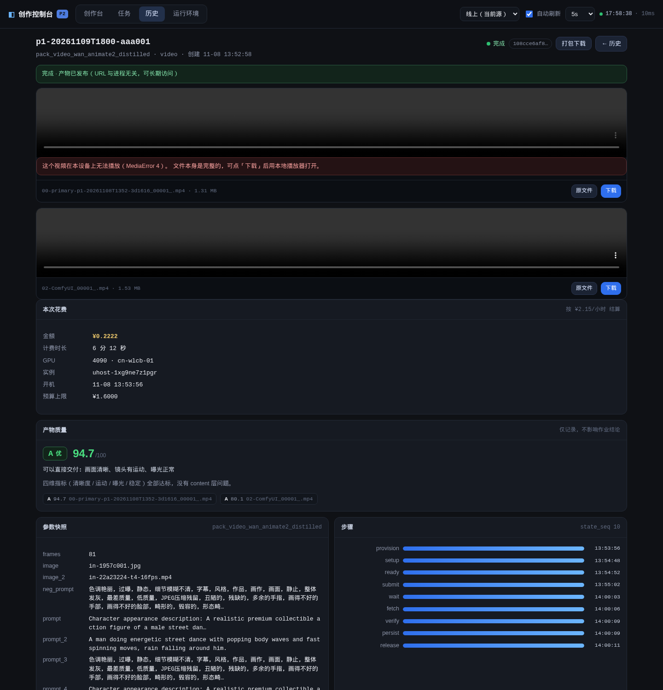
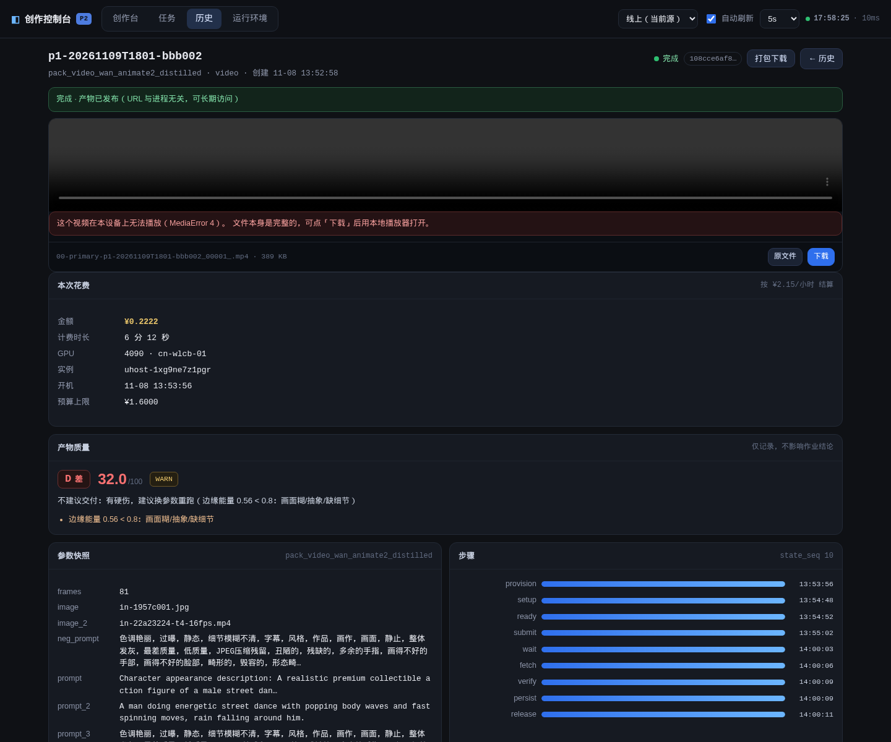
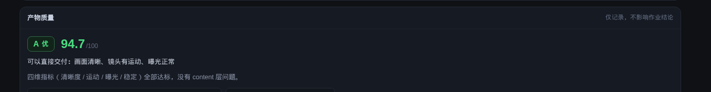
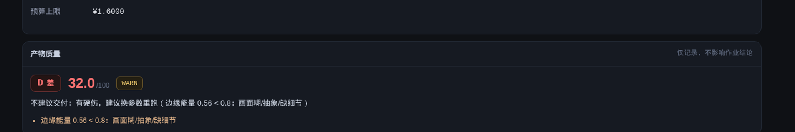
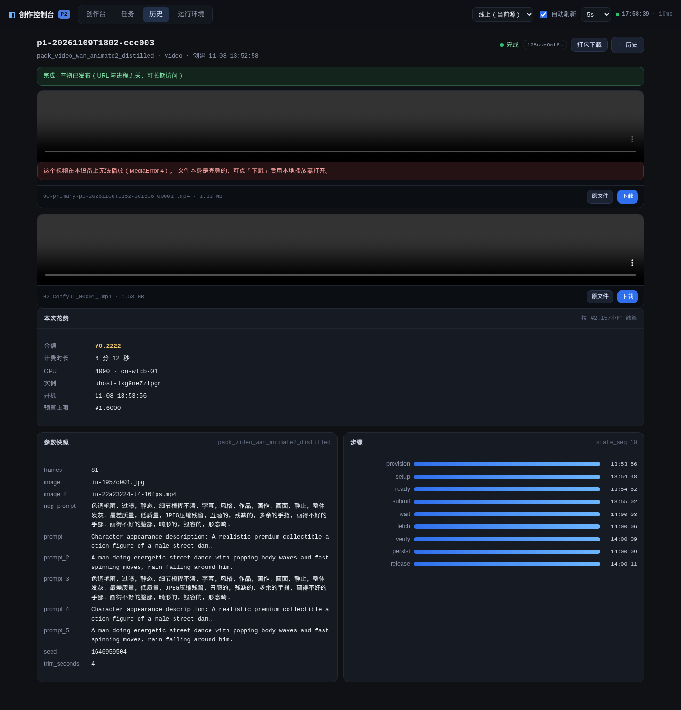
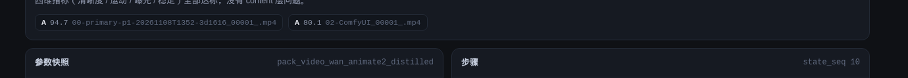

# P5 · 把质量分接进控制台 UI

> 分支 `feat/l5-l6-completion` · 2026-11-09 · 起点 `0a8ab93`
> 任务来源：`reports/audit/交接单-L5L6后续-20261109.md` §4 P5
> 关联：`reports/audit/L5-L6补完-20261109.md` §4 L6-A 质量判定

---

## 0. 一句话结论

**质量分从「只在 manifest.json 里」变成「详情页看得见」。**

`tools/p2/quality.py` 这套评分（四维指标 + 木桶封顶 + 0-100 分 + A/B/C/D + issues）
上一轮就做出来了，但只落盘不露面 —— 用户跑完只看得到「文件成功」。现在作业详情页
在成本卡下面多一张质量卡：

```
A 优  94.7/100          可以直接交付：画面清晰、镜头有运动、曝光正常
D 差  32.0/100  WARN    不建议交付：有硬伤，建议换参数重跑（边缘能量 0.56 < 0.8：画面糊/抽象/缺细节）
```

**门禁语义一点没动。** `from_expect()` 依旧默认 `mode="report"`，UI 上只展示，
卡头明写「仅记录，不影响作业结论」。现存 30 条 verified 工作流不会被重判。

---

## 1. 改了什么

7 个文件（含 1 个新增测试脚本），+427 行左右：

| 文件 | 改了什么 |
|---|---|
| `webui/api.py` | 新增 `read_manifest()`；`get_job()` 返回顶层 `quality` |
| `web/dist/app.js` | 新增 `qualityCard()`，在 `costCard()` 之后渲染 |
| `web/dist/app.css` | `.qcard` 一族样式（A/B/C/D 四档配色） |
| `docs/openapi.json` | `JobDetail` 补 `cost` 与 `quality`（两份 example 同步） |
| `web/tests/quality_card.test.js` | **新增**，21 条前端单测（真跑 `qualityCard()`） |
| `tools/webui/tests/test_api.py` | 新增 `TestQualityPassthrough`，8 条 |
| `tools/webui/tests/test_frontend_units.py` | 新增 `TestResultQualityCard`，7 条 |
| `web/README.md` | 测试基线 310 → 509 |

### ① 后端：`webui/api.py`

```python
def read_manifest(job_id, jobs_dir=None) -> dict:
    """读 manifest.json；没有/读不出来一律返回 {}。"""
```

抽成单独函数的原因：`list_jobs()` 里已经有一份几乎一样的读法（只取 cost），
两边各写一遍就等于以后必然有一边忘了改。顺手把「manifest 是派生文件，
坏了不能拖垮详情页」这条口径集中在注释里。

```python
def get_job(job_id, jobs_dir=None) -> dict:
    ...
    man = read_manifest(job_id, jobs_dir)
    cost = man.get("cost") or None
    quality = man.get("quality")
    if not isinstance(quality, dict) or not quality:
        quality = None
    return {"job": job, "cost": cost, "quality": quality, ...}
```

三个决定：

**① `quality` 放顶层，与 `cost` 并列，不进 `job`。**
`job.json` 里根本没有这个字段，塞进 job 就是读到 None —— `costCard()` 当初
就是这么写错的（历史 bug，注释里留着）。

**② 未完成作业返回 `null` 而不是报错。**
manifest 只在 `step_persist()` 之后才存在。拿一个 CREATED/RUNNING 作业调详情
接口，`quality` 和 `cost` 都是 `null`，页面照常渲染，只是不画质量卡。

**③ `quality={}` 归一成 `null`。**
`run.py` 写的是 `"quality": res.get("quality") or {}` —— 评分器抛异常时也会留
一个空对象。对 UI 来说「空对象」和「没有」是同一件事（都不渲染），所以后端
统一成 `None`，前端不用猜两种形状。

### ② 前端：`web/dist/app.js`

新增 `QGRADE` 文案表 + `qualityCard(q)`，插在 `costCard()` 后面：

```js
${costCard(S.detail.cost, job)}
${qualityCard(S.detail.quality)}
```

卡片内容：

- **等级徽章**：`A 优` / `B 良` / `C 中` / `D 差`，四档不同颜色（绿/蓝/琥珀/红）；
- **分数**：`94.7/100`，一位小数，等宽数字；
- **一句人话结论**：有 issue 就点名第一个（比「良/中」这种等级词有用得多）；
- **issues 列表**：原文显示，如 `边缘能量 0.56 < 0.8：画面糊/抽象/缺细节`；
- **verdict 角标**：WARN / FAIL 才挂，PASS 不挂（不制造视觉噪音）；
- **多产物汇总**：主产物之外的分与等级排成 chips，并把附加产物的 issue 按文件名归属。

**没有 quality 数据时 `qualityCard()` 直接 `return ''`** —— 返回空串，`innerHTML`
里什么都不留，不是渲染一个「质量 —」的空壳。

### ③ 样式：`web/dist/app.css`

`.qcard` 沿用 `.costcard` 那套排版（`grid-column:1/-1` 整行铺开、`h3` + `.r` 副标），
新增 `.qbadge` / `.qscore` / `.qsay` / `.qissues` / `.qnowe` / `.qchip`。
四档色带：

```
A  #4ade80  绿     B  #6cb6ff  蓝     C  #e8c46a  琥珀     D  #f87171  红
```

颜色只表达等级，不表达「通过/不通过」—— 因为 report 模式下根本没有「不通过」。

---

## 2. 怎么验证的

### 2.1 全套测试：494 → 509（+15 条，全绿）

```
tools/p20/tests    Ran 105 tests   OK
tools/p1/tests     Ran  84 tests   OK
tools/p2/tests     Ran 159 tests   OK
tools/webui/tests  Ran 161 tests   OK     ← 146 + 15
```

新增 15 条：

| 位置 | 条数 | 覆盖 |
|---|---|---|
| `web/tests/quality_card.test.js` | 21 | 真跑 `qualityCard()`（下表逐条） |
| `tools/webui/tests/test_api.py::TestQualityPassthrough` | 8 | 后端透出/降级/坏文件 |
| `tools/webui/tests/test_frontend_units.py::TestResultQualityCard` | 7 | 接入点与「不是门禁」 |

前端那 21 条里关键的是**负向断言**，只 grep 源码看不出来、必须真的传值跑：

```
ok  null 不渲染
ok  undefined 不渲染
ok  空对象不渲染（老 manifest 写的 quality={}）
ok  缺 overall 不渲染（只有 error 字段的评分失败）
ok  overall 非数字不渲染
ok  字符串当 quality 传进来不渲染
ok  D 级不能被渲染成绿色
ok  未知等级降级成 x 档而不是崩掉
ok  issues 原文显示（report 模式下用户只能看见这行字）
ok  文件名与 issue 都做 HTML 转义（产物名可能含 <）
```

后端 8 条覆盖：顶层透出 / D 级 issue 原样 / 未完成作业 → null / 老 manifest 无字段 → null /
`quality={}` → null / manifest JSON 写坏 → 不 500 / `read_manifest()` 契约 / gate 模式照样透出。

**没有一条 `skipTest`。** 前端测试也只在 node 缺失时跳过（既有约定），本机有 node v24.9.0。

### 2.2 后端真的透出 quality（curl，走 nginx 同源路径）

```bash
$ curl -sk "https://127.0.0.1/files/3501cd88/api/p2/jobs/p1-20261109T1800-aaa001" \
    | python3 -c "import json,sys;d=json.load(sys.stdin);print(list(d))"
['job', 'cost', 'quality', 'artifacts', 'workflow', 'terminal']
```

三种情形实测：

| 作业 | 情形 | `cost` | `quality` |
|---|---|---|---|
| `p1-20261109T1800-aaa001` | DONE + 新 manifest | `{hourly:2.15, minutes:6.2, amount:0.2222}` | `overall 94.7 / A / PASS / report` |
| `p1-20261109T1802-ccc003` | DONE + **老** manifest（无 quality） | 同上 | `null` |
| `p1-20261109T1803-ddd004` | RUNNING（没跑到 PERSISTED） | `null` | `null` |

> 这三个作业是从**真实作业** `p1-20261108T1352-3d1616` 克隆出来的验证夹具，
> 产物是仓库里真实产出的 mp4，分数是真跑 `assess_job()` 算的，不是手填。
> `reports/p1/jobs/` 本来就在 `.gitignore` 里，不会入库。

低分那条用的是已知失败样本 `reports/p1/ltxv-debug/attempt2.mp4`：

```
$ python3 -m tools.p2.l5l6 quality reports/p1/ltxv-debug/attempt2.mp4
🔴  32.0 D  attempt2.mp4
        清晰 0.564 · 运动 2.982 · 亮度 51.8 · 范围 147.0 · 变异 0.089
        ! 边缘能量 0.56 < 0.8：画面糊/抽象/缺细节
```

### 2.3 前端真的显示（无头浏览器截图）

chrome-headless-shell 153 直接打公网同源地址，`#/result/<job_id>` 路由：

```bash
CH=/root/.cache/ms-playwright/chromium_headless_shell-1243/chrome-headless-shell-linux64/chrome-headless-shell
$CH --headless --disable-gpu --no-sandbox --ignore-certificate-errors \
    --window-size=1440,1500 --virtual-time-budget=9000 \
    --screenshot=out.png "https://127.0.0.1/files/3501cd88/ui/#/result/<job_id>"
```

**A 级（94.7 分，两个产物）** —— `reports/ui-shots/p5-quality-A.png`



**D 级（32.0 分，已知失败样本）** —— `reports/ui-shots/p5-quality-D.png`



放大看卡片本体：




**老 manifest（无 quality 字段）→ 整张卡不渲染** —— `reports/ui-shots/p5-quality-none.png`



DOM 层面也数了一遍（`--dump-dom` + `grep -c 'class="card qcard"'`）：

```
p1-20261109T1800-aaa001  → 1    有 quality，卡片在
p1-20261109T1802-ccc003  → 0    老 manifest，卡片不在（成本卡还在）
p1-20261109T1803-ddd004  → 0    RUNNING，卡片不在
```

**运行中作业** 的截图（`p5-quality-running.png`）确认：成本卡显示 `—`、没有质量卡，
页面其余部分正常，不报错。

**多产物汇总** —— `reports/ui-shots/p5-quality-chips.png`



---

## 3. 三个没踩回去的坑

**① `web/dist` 是源码，不是构建产物。**
改之前先验了 `git check-ignore -v web/dist/app.js` → 退出码 1（不被忽略），
`.gitignore` 里那条根规则是锚定的 `/dist/`。既有测试
`TestGitignoreDoesNotSwallowSource` 也一直在守着这条。

**② `quality` 跟 `cost` 一样放顶层。**
`costCard()` 当年就是因为从 `job.cost` 读而永远是 `—`。新增的测试里有一条
`assertNotIn("quality", out["job"])` 把这条钉死；前端也有一条 regex
`\bjob\.quality\b` 不许出现。

**③ 没把质量分做成门禁。**
- 后端：`from_expect()` 默认 `mode="report"`，一行没动；
- 前端：只读不写，卡头写「仅记录，不影响作业结论」；
- 测试：`test_report_mode_is_not_a_gate` 断言 `app.js` 里不存在
  `质量门禁未通过` / `blockedByQuality` / `qualityBlock` 这类拦截入口。

改默认门禁等于把 30 条 verified 全部重判一次（必然有几条被打低，需要人一条条看），
这不是一次改动能决定的事。

---

## 4. 顺手做的两件事

**① `docs/openapi.json` 补契约。**
`JobDetail` 之前连 `cost` 都没有 —— 那份契约落后于实现已经有一阵了。这次把
`cost` 和 `quality` 都写进去（含 `null` 语义说明），两份 example 同步。
`test_openapi_consistency` 那组既有用例依旧全绿。

**② `web/README.md` 的基线从 310 改成 509。**
那个数字停在很久以前（310 vs 实际 494），既有的
`test_documents_test_baseline` 只校验「各套件之和 == 总数」，不校验真实值，
所以它一直绿着但内容是错的。这次一并更新。

---

## 5. 没做的（有意）

| 没做 | 为什么 |
|---|---|
| 给列表页也加质量徽章 | 列表接口要读 N 个 manifest，20 条作业 = 20 次读盘；这次只做详情页 |
| 加「按质量排序/筛选」 | 同上，等列表页真有需求再说 |
| 把分数画成雷达图/趋势 | 单条作业只有一个分数，没有时间序列可画 |
| 加「一键重跑低分作业」 | 会顺手引入「质量驱动调度」，那是门禁的变种，与本次约束冲突 |
| `mode=gate` 的开启入口 | 用户没有要求，且开了就是改动 30 条 verified 的判定口径 |

---

## 6. 验收命令（可复现）

```bash
cd /root/智云视频工作流

# 全套测试
for d in tools/p20/tests tools/p1/tests tools/p2/tests tools/webui/tests; do
  printf "%-22s " "$d"
  python3 -m unittest discover -s $d -t . 2>&1 | grep -E "^Ran |^OK$|^FAILED" | tr '\n' ' '; echo
done

# 前端质量卡单测（21 条）
cd web && node tests/quality_card.test.js

# 后端透出
curl -sk "https://127.0.0.1/files/3501cd88/api/p2/jobs/p1-20261109T1800-aaa001" \
  | python3 -m json.tool | grep -A6 '"quality"'
```

---

## 7. 公网可点链接（token `3501cd88`）

本报告：

https://123.207.74.155/files/3501cd88/f/reports/audit/P5-%E8%B4%A8%E9%87%8F%E5%88%86%E6%8E%A5UI-20261109.md

截图直链：

- A 级（94.7 分）：https://123.207.74.155/files/3501cd88/f/reports/ui-shots/p5-quality-A.png
- D 级（32.0 分）：https://123.207.74.155/files/3501cd88/f/reports/ui-shots/p5-quality-D.png
- A 级卡片本体：https://123.207.74.155/files/3501cd88/f/reports/ui-shots/p5-quality-card-A.png
- D 级卡片本体：https://123.207.74.155/files/3501cd88/f/reports/ui-shots/p5-quality-card-D.png
- 老 manifest 无卡片：https://123.207.74.155/files/3501cd88/f/reports/ui-shots/p5-quality-none.png
- 运行中作业：https://123.207.74.155/files/3501cd88/f/reports/ui-shots/p5-quality-running.png
- 多产物 chips：https://123.207.74.155/files/3501cd88/f/reports/ui-shots/p5-quality-chips.png

控制台：

https://123.207.74.155/files/3501cd88/ui/#/result/p1-20261109T1800-aaa001
https://123.207.74.155/files/3501cd88/ui/#/result/p1-20261109T1801-bbb002

> 注意 `share/` 里的文件走 `/f/` 前缀（`/files/<token>/f/reports/...`）。
> 不带 `/f/` 是 404 —— 那是 `/pub/`（nginx 直读 `/srv/dsh-pub`）的语义，
> 与 `artUrl()` 里 `SAME_BASE` 那段处理是同一个坑：站内绝对路径要补前缀。

---

## 8. 验证夹具（可随时删）

`reports/p1/jobs/` 在 `.gitignore` 里，下面 4 个目录是**本轮临时造出来的验证夹具**
（从真实作业 `p1-20261108T1352-3d1616` 克隆，产物是真 mp4，分数是真跑出来的）：

```
p1-20261109T1800-aaa001   DONE   quality 94.7 A   （真实产物 2 路）
p1-20261109T1801-bbb002   DONE   quality 32.0 D   （已知失败样本 attempt2.mp4）
p1-20261109T1802-ccc003   DONE   老 manifest，无 quality 字段
p1-20261109T1803-ddd004   RUNNING 没跑到 PERSISTED，无 manifest
```

不需要了直接删（不影响任何入库文件）：

```bash
rm -rf reports/p1/jobs/p1-20261109T18*
```

留着的好处是上面那些链接和截图可以随时复验。
