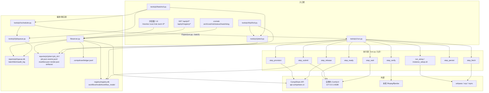

# P2.0 任务 1：现有调用关系审查

> 审查时点：2026-11-01 21:10（基线 `ca2a352`，工作区已含 P2.0 新增的 `tools/p20/`）。
> 审查方法：静态读代码 + `grep` 调用点 + 实跑 `p20ctl` / `jobctl validate` / `p2` 单测交叉验证。
> 范围：UI（fileserver 页面 + `/api/p2`）、全部 CLI 入口、P1 执行器、P2 队列/调度器、P2.0 Registry、CompShare/ComfyUI 外部接口、cron。
> 本文把「P2.0 改造前就存在」与「P2.0 新增」分开标注，避免把新链路混进基线。

---

## 0. 结论摘要（先看这 8 条）

1. **系统不是一条链，而是四条半链**：①UI 只读链；②单任务 CLI 链（jobctl→run.py）；③批量调度链（batchctl→scheduler→run.py）；④P2.0 配置链（p20ctl→registry→render→run.py）；外加 cron 旁路（arch/cost/risk/status2/watchdog）。
2. **作业事实只有一个来源**：`reports/p1/jobs/<job_id>/job.json` + `events.jsonl` + `manifest.json`；`queue.db` 只放队列事实，`status2.json` 只是聚合快照。四条链最终都读写这同一组文件。
3. **UI 目前是纯读的**：`fileserver.py` 只有 GET（例外：`POST /upload` 上传文件）；提交/取消/重试全部在 CLI。`docs/API.md` 也明确写了「无写接口」。
4. **UI 原型页不在当前分支**：`reports/p2/ui/prototype.html` 只在 `feature/ui` 分支（`git show feature/ui:...`），当前 `HEAD` 没有；UI 对接面 = `fileserver` 的服务端页面 + `/api/p2/*`。
5. **执行器是「一实例一 job、九步串行」**：`run.py` 用状态机把 9 个步骤串起来，每一步先转移状态（守卫/ CAS）再执行动作；G1（未 PERSISTED 不许 RELEASING）和 G2（DONE 必须 PASS）是硬约束。
6. **ComfyUI 不在本机**：实例内 `127.0.0.1:8188`，宿主通过 `sshpass ssh root@<ip>` 在远端执行 `python3 -c "urllib..."` 调 `/object_info`、`/prompt`、`/history/<pid>`；产物用 `scp` 从 `/root/ComfyUI/output/` 拉回。没有公网端口、没有 HTTP 直连。
7. **P2.0 只在「渲染/资产检查/复验」三个边界插入**：`step_submit` 的 `render_job()`、`step_ready` 的 `assets.run_check()`、`step_verify` 的 bindings 回读；调度器、队列、状态机、`run.py` 的九步顺序一行未改。
8. **最大的结构性风险不是并发，是「节点/参数知识散落」**：`run.py` 的 5 个占位符、`verify.py` 的 `_PARAM_NODES` 白名单、`instance_setup.sh` 的 6 个资产名、`jobctl.py` 的默认 expect，四份知识各写各的，新增模型必然要动其中至少两处。这正是 P2.0 要解耦的部分。

---

## 1. 调用关系总图

### 1.1 分层图（Mermaid）



### 1.2 四条主链（按执行顺序）

#### 链 A：UI 只读链（不产生作业）

```
浏览器
  └─ nginx /files/  ──反代──▶ fileserver.py:do_GET
       ├─ /<token>/                 → _index()                      读 share/
       ├─ /<token>/monitor          → _monitor_page()               → _api_status()
       │     → compshare.cs.CS: balance()/instances()/inventory_raw()
       │     → reports/p2/status2.json
       ├─ /<token>/cost             → _cost_page()                   → _api_cost()
       │     → .compshare/ledger.jsonl + lab/state.json + CS.balance()
       ├─ /<token>/risk             → _risk_page()                   → reports/risk/latest.json
       ├─ /<token>/arch             → _arch_page()                   → tools/arch.py --no-sync
       ├─ /<token>/api/p2/queue     → _api_p2(["queue"])            → jobqueue.stats/items
       ├─ /<token>/api/p2/jobs[/id] → _api_p2(["jobs",...])        → queue.db + jobs/<id>/*
       ├─ /<token>/api/p2/audit     → jobqueue.audit_since()
       ├─ /<token>/api/p2/events    → jobs/<id>/events.jsonl
       └─ /<token>/api/p2/registry/* → _api_registry()              → tools/p20/registry.py
```

输入：HTTP GET + token；输出：HTML / JSON / SVG / 文件流。
副作用：`/arch` 会触发 `tools/arch.py --no-sync` 重算 SVG（20s 缓存）；`/api/p2/registry/*` 会触发 `registry.ensure_fresh()`（配置指纹变了会自动重建派生库）；其余只读。

#### 链 B：单任务 CLI 链（P1 保留路径）

```
jobctl.py new --spec X.json
  ├─ schema.validate_job() / store.params_hash() / ids.new_job_id()
  ├─ store.ensure_job_dir()          ← mkdir 原子占位
  └─ state.init_job()                → jobs/<id>/job.json + events.jsonl

run.py <job_id>
  └─ _lock()（legacy=全局 flock；--batch=per-job flock）
       └─ _execute()：
            provision → setup → ready → submit → wait → fetch
            → verify → persist → release
         每步 state.transition() 先过 TRANSITIONS/G1/G2/CAS，再执行动作；
         失败落 FAILED_*，_keep_instance() 保留实例并设 stop_at 兜底。
```

#### 链 C：批量调度链（P2）

```
batchctl.py submit --specs '...'
  ├─ 每个 spec 调 jobctl.py new（子进程，复用校验/查重/原子占位）
  └─ jobqueue.submit(batch_id, job_id, params_hash, ...) → queue.db item(state=queued)

batchctl.py run
  └─ Scheduler.run() loop
       ├─ once(): reap_children / reset_stale / reap_instances / budget / quota
       ├─ claim(): BEGIN IMMEDIATE 原子领取 → state=claimed
       └─ _spawn(): Popen(run.py <jid> --batch --no-keep --restart --gpu ...)
            run.py 内 _start_heartbeat() 每 15s → queue.heartbeat()
            子进程退出 → queue.finish() / queue.requeue() / queue.defer()
```

#### 链 D：P2.0 配置链（本轮新增）

```
p20ctl.py import
  └─ registry.import_all()
       ├─ config_schema.validate_model/workflow/compat
       ├─ 读 registry/models/*.json、registry/workflows/*.json、registry/compat.json
       └─ 写 registry/registry.db（派生索引）

p20ctl.py new --workflow K --model M --params P
  └─ registry.resolve()（兼容性门禁 + 默认值 + 类型/范围校验）
       └─ render.render()（预演；--dry-run）
            └─ 生成 reports/p2/p20/specs/*.json
                 └─ jobctl.py new（链 B）

run.py <jid>（registry job）
  ├─ step_ready   → assets.run_check()  → ssh → ComfyUI /object_info
  ├─ step_submit  → render.render_job() → registry.db → graph
  │                    └─ 写 jobs/<id>/render.json（实际提交图 + 元数据）
  ├─ step_verify  → verify_job(rendered_graph, wf_config) → bindings 回读参数
  └─ step_persist → manifest.registry（workflow/model 版本、compat、graph sha）
```

---

## 2. 调用点清单（输入 / 输出 / 失败行为）

### 2.1 入口 → 编排

| # | 调用点 | 函数/命令 | 输入 | 输出 | 失败行为 |
|---|---|---|---|---|---|
| 1 | `fileserver.py:302` | `do_GET` | HTTP GET + token | HTML/JSON/SVG/文件 | token 错→404；路径错→404 |
| 2 | `fileserver.py:476` | `_api_registry` | path + query（workflow/model/params） | JSON | 配置错→400；未知 key→404；模块异常→500 |
| 3 | `fileserver.py:573` | `_api_p2` | path + query（job/since/limit） | JSON | 缺 job→400；作业不存在→404 |
| 4 | `fileserver.py:664` | `_api_status` | 无 | 余额/实例/库存/服务/P2 快照 | 平台异常写入 `errors[]`，页面不崩 |
| 5 | `fileserver.py:752` | `_api_cost` | 无 | 账本聚合 | 同上 |
| 6 | `jobctl.py:138` | `cmd_new` | `--spec` JSON | job 目录 + job.json + events | spec 非法→退出 1；同 hash 已 DONE→拒绝（`--force` 放行） |
| 7 | `p20ctl.py` `cmd_new` | `new` | workflow/model/params | spec + job_id | 兼容性未验证→拒绝；参数非法→拒绝 |
| 8 | `batchctl.py:48` | `cmd_submit` | `--specs` glob | queue.db item | 单个 spec 失败不阻断其余 |
| 9 | crontab | `arch/cost/risk/status2/watchdog` | 定时 | 写 reports/、queue 状态 | 各自日志，互不阻塞 |

### 2.2 执行器九步（`run.py`）

| 步 | 函数（当前行） | 输入 | 输出/副作用 | 失败态 |
|---|---|---|---|---|
| provision | `step_provision` 221 | job.model/instance/budget、`--gpu/--hours` | CompShare 实例、job.instance、steps.provision | `FAILED_PROVISION` |
| setup | `run_setup` 317 + `_apply_model_links` 339 | uhost_id、`--need`、模型 `setup.links` | 远端 yaml/软链/ComfyUI 启动 | `FAILED_PROVISION` |
| ready | `step_ready` 358 | host/port/pwd、模型资产规则 | 等待 8188 + 资产可见 | `FAILED_PROVISION` |
| submit | `step_submit` 397 | job.model/params、registry 或模板图 | `render.json`（registry）、`prompt_id` | `FAILED_RUN` |
| wait | `step_wait` 440 | prompt_id、budget.max_minutes | 远端文件列表 `[(sub, filename)]` | `FAILED_RUN` / `FAILED_FETCH`（成功但无输出） |
| fetch | `step_fetch` 471 | 文件列表、scp | `artifacts/01-*` | `FAILED_FETCH` |
| verify | `step_verify` 488 | artifacts、expect、图/绑定 | `{verdict, checks, artifacts}` | `FAILED_VERIFY` |
| persist | `step_persist` 514 | 复验结果、实例信息 | `manifest.json`（原子写+读回） | `FAILED_VERIFY` |
| release | `step_release` 584 | uhost_id / from_pool | terminate 或回池 | `FAILED`（8903 重试 3 次） |
| done | `step_done` 626 | manifest | 补 `release_at` / `state_history` | — |

### 2.3 执行器 → 外部

| 调用点 | 目标 | 协议/命令 | 输入 | 输出 |
|---|---|---|---|---|
| `step_provision` | CompShare | `compshare/cs.py:CS.create/wait_state/price/stock/balance` | 镜像 ID、卡型、CPU/内存、100G 盘 | 实例 ID、公网 IP、密码 |
| `step_provision` | 实例 | `sshpass ssh ... "echo ssh-ready"` | host/port/pwd | sshd 就绪 |
| `run_setup` | 实例 | `bash tools/p1/instance_setup.sh <id> --need=...` | uhost_id、`P1_HOST/P1_PORT/P1_PASSWORD` | yaml/软链/ComfyUI 进程 |
| `step_ready` | ComfyUI | `GET /object_info`（远端 urllib） | 无 | UNET/CLIP/VAE 候选列表 |
| `step_submit` | ComfyUI | `POST /prompt`（远端 urllib） | `{prompt: graph, client_id}` | `{prompt_id}` |
| `step_wait` | ComfyUI | `GET /history/<pid>`（轮询） | prompt_id | `status_str` / `outputs` |
| `step_fetch` | 实例 | `scp root@host:/root/ComfyUI/output/<file>` | 远端路径 | 本地 artifacts 文件 |
| `step_verify` | 本机 | `ffprobe` / `ffmpeg signalstats/freezedetect` | 产物 | 解码/尺寸/帧数/黑帧/冻结/参数 |
| `step_release` | CompShare | `CS.terminate` | uhost_id | 实例删除 |
| `batchctl` | 平台 | `CS.instances()` / `terminate` | 无 | 僵尸实例回收 |
| `arch/risk` | 平台 + 本地 | `CS.balance/instances`、读 ledger/queue | 无 | SVG / risk JSON |

### 2.4 读模型 → 视图（单向，不反写作业）

| 生产者 | 产物 | 消费者 |
|---|---|---|
| `run.py` / `jobctl.py` | `jobs/<id>/job.json`、`events.jsonl`、`manifest.json` | `status.py`、`status2.py`、`gallery.py`、`fileserver`、`arch.py` |
| `jobqueue.py` | `queue.db`（batch/item/audit_log） | `scheduler.py`、`batchctl list/show`、`fileserver /api/p2/queue|jobs|audit`、`riskmon` |
| `run.py:_ledger` | `.compshare/ledger.jsonl` | `csctl cost/status`、`fileserver /cost`、`status` |
| `registry.import_all` | `registry/registry.db` | `p20ctl`、`run.py render_job`、`fileserver /api/p2/registry/*` |
| `status2.py` | `reports/p2/status2.json` | `fileserver /monitor`、`/api/status` |
| `arch.py` | `reports/architecture.svg` | `fileserver /arch`、`/api/arch` |
| `riskmon.py` | `reports/risk/latest.json` | `fileserver /risk` |
| `image.py` / `pool.py` | `reports/p2/image.json` / `pool.json` | `run.py:_pick_image` / `pool.acquire` |

---

## 3. 文件清单（每个调用点的输入/输出）

> 路径相对仓库根。★ = P2.0 新增或改动。

| 文件 | 角色 | 输入 | 输出 / 副作用 |
|---|---|---|---|
| `fileserver.py` | UI + 只读 API 服务 | HTTP GET/POST（token） | HTML/JSON/SVG/文件流；`/arch` 触发 arch.py；`/api/p2/registry` 触发 ensure_fresh |
| `csctl.py` | 基础设施 CLI | 子命令参数、credentials.env | 平台调用、本地 state/stop_at/watch 日志、账本 |
| `compshare/cs.py` | CompShare 薄封装 | AK/SK、action/params | API JSON → dict；签名/重试/分页 |
| `tools/transfer.py` | scp/tar/rsync 传输 | 本地/远端路径 | 文件、目录；超时返回 124 |
| `tools/p1/jobctl.py` | 作业 CLI | spec JSON | `jobs/<id>/job.json`、`events.jsonl`；校验/查重 |
| `tools/p1/run.py` ★ | 九步执行器 | job.json、opts、registry 配置 | 状态转移、实例、artifacts、manifest、render.json、ledger |
| `tools/p1/state.py` | 15 态状态机 | job_id、目标态 | events.jsonl 追加、job.state/state_seq 原子更新 |
| `tools/p1/store.py` | 路径/原子写/锁/hash | JSON、job_id | tmp→fsync→rename；flock |
| `tools/p1/schema.py` | 契约校验 | job/manifest/tasks | 错误列表（不抛） |
| `tools/p1/verify.py` ★ | 产物复验 | artifacts、expect、workflow/绑定 | 7 项 checks + warnings |
| `tools/p2/freeze.py` | freezedetect | 视频文件 | freeze_ratio/longest/events；严格门禁 |
| `tools/p2/jobqueue.py` | 队列 | claim/heartbeat/finish/audit | `reports/p2/queue.db` |
| `tools/p2/scheduler.py` | 调度器 | queue.db、平台实例、账本 | 子进程 run.py、回收、重排 |
| `tools/p2/batchctl.py` | 批量 CLI | specs/glob | 队列项、调度器进程 |
| `tools/p2/status2.py` | 多作业快照 | job.json + queue.db | `reports/p2/status2.json` |
| `tools/p2/image.py` | 镜像烘焙 | 层/卡型/名称 | 平台镜像、`reports/p2/image.json` |
| `tools/p2/pool.py` | 预热池（M5） | 实例 | `reports/p2/pool.json` |
| `tools/p20/config_schema.py` ★ | 配置契约 | model/workflow/compat JSON | 错误列表 / 图结构指纹 |
| `tools/p20/registry.py` ★ | 登记库 | registry/*.json | `registry/registry.db`、解析结果、兼容性 |
| `tools/p20/render.py` ★ | 参数映射 | workflow/model/params | ComfyUI API 图、元信息 |
| `tools/p20/assets.py` ★ | 资产检查 | 模型 files/links | 远端 `ASSET_CHECK`、软链 |
| `tools/p20/comfy.py` ★ | ComfyUI 协议 | /prompt /history 文本 | prompt_id、文件列表、错误 |
| `tools/p20/p20ctl.py` ★ | Registry CLI | import/resolve/new/compat | DB、spec、job、兼容性文件 |
| `tools/arch.py` | 架构图 | job/queue/账本 | `reports/architecture.svg/.png/.html` |
| `tools/riskmon.py` | 风险监控 | 平台、队列、账本 | `reports/risk/latest.json` |
| `tools/gallery.py` | 画廊 | artifacts | `reports/*/gallery*.html` |
| `tools/checkpoint.py` / `path_lifecycle_summary.py` | 存储巡检 | SSH/lab/checkpoint.sh | `reports/checkpoint/*.json` |
| `tools/cost_snapshot.py` | 成本快照 | 账本 | 日志/报告 |
| `tools/p1/instance_setup.sh` | 实例环境 | uhost、`--need`、P1_HOST… | yaml、软链、ComfyUI 启动、自检 |
| `tools/p1/cases.py` | P1 回归 | 无（本机） | 13 条 PASS/FAIL/SKIP |
| `workflows/*.api.json` | ComfyUI 图 | — | 图（含模型名/静态参数/占位符） |
| `registry/workflows/*.json` ★ | 工作流配置 | — | 图路径、槽位、参数绑定、输出、期望 |
| `registry/models/*.json` ★ | 模型配置 | — | 权重文件、默认值、约束、资产规则 |
| `registry/compat.json` ★ | 兼容性 | — | verified/incompatible 证据 |
| `reports/p2/queue.db` | 队列事实 | — | batch/item/audit_log |
| `reports/p1/jobs/<id>/job.json` | 作业事实 | — | 状态、params、model、steps |
| `reports/p1/jobs/<id>/events.jsonl` | 状态事件 | — | `{seq,from,to,reason,at}` |
| `reports/p1/jobs/<id>/manifest.json` | 产物事实 | — | artifacts sha256、checks、verdict、cost、registry |
| `reports/p1/jobs/<id>/render.json` ★ | 实际提交图 | — | graph + workflow/model 版本 + compat |
| `reports/p1/jobs/<id>/artifacts/` | 产物 | — | mp4/png |
| `reports/p2/status2.json` | 多作业快照 | — | 聚合 |
| `registry/registry.db` ★ | 派生索引 | — | 可删可重建 |
| `.compshare/ledger.jsonl` | 成本账本 | — | 每 job 一行 |
| `.share_token` | UI token | — | 鉴权 |
| `docs/API.md` | API 契约 | — | 只读 API 文档 |
| `reports/p2/ui/prototype.html`（feature/ui） | UI 原型 | — | 只读前端，未合并 |

---

## 4. 关键发现与风险（按影响排序）

| # | 发现 | 证据 | 影响 | P2.0 处理 |
|---|---|---|---|---|
| F1 | 渲染知识写死在 `run.py`：5 个占位符 | `run.py:127-147` | 新节点/新参数必须改执行器 | `render_job()` 配置化，legacy 分支保留 |
| F2 | 参数复验节点白名单 `_PARAM_NODES` | `verify.py:36-43` | 新节点类无法复验 → params 跳过 | registry 作业走 bindings 回读；legacy 不动 |
| F3 | 资产名写死在 setup/ready | `instance_setup.sh:46-51`、`run.py:387` | 新模型要么改脚本，要么「假装可见」 | 模型配置 `files`/`assets` 生成远端检查 |
| F4 | 默认 expect/budget/卡型写死在 jobctl | `jobctl.py:31-37` | 图/模型换了，期望值还是旧的 | workflow `expect_defaults` + `limits` |
| F5 | 模型文件名写死在 5 张图里 | `workflows/*.api.json` | 换权重=改图，params_hash 变 | 模型 `files` + 工作流 `slots` 注入 |
| F6 | UI 只读，写操作全在 CLI | `docs/API.md §5`、`fileserver.py:302` | 「在页面上提交一个工作流」目前做不到 | 本轮只加 registry 只读 API；写 API 留二期（需幂等令牌） |
| F7 | `queue.db` 与 `job.json` 双事实 | `jobqueue.py`、`store.py` | 对账靠 `doctor`/`watchdog`，易漂移 | 不动模型，只在报表里区分「队列态/作业态」 |
| F8 | 同一 params 可能被手工与批量各跑一次 | `jobctl._find_same_hash` 只扫 jobs/；`ux_item_params_active` 只扫活跃队列 | 双花 | 已在 P2 硬化；P2.0 不扩大 |
| F9 | `run.py` 失败保留实例 15 分钟 | `run.py:784` `KEEP_MINUTES` | 无人值守会白烧 | 批量用 `--no-keep`；P2.0 沿用 |
| F10 | UI 原型页未合并 | `git show feature/ui:reports/p2/ui/prototype.html` | 不能把原型当现有 UI | 文档明确标注，不基于它做验收 |

---

## 5. P2.0 的边界（哪些能碰、哪些不能碰）

**能碰（已碰）**：
- 新增 `tools/p20/`、`registry/`、`workflows/qwen_image_t2i_portrait.api.json`；
- `run.py` 的 4 个 additive hook（ready/submit/verify/persist）+ `_need` + 模型软链；
- `verify.py` 增加可选 `wf_config` 参数（legacy 不传则行为不变）；
- `fileserver.py` 增加 `/api/p2/registry/*` 只读路由。

**不能碰（本轮零改动）**：
- 15 态状态机 + `TRANSITIONS` + G1/G2 + CAS（`state.py` 一行未改）；
- `jobctl.py` 的 `new` 语义、`schema.py` 的 job/manifest 契约（只允许未知键）；
- `queue.db` DDL、`scheduler.py`、`jobqueue.py`、`batchctl.py`；
- `params_hash` 算法（model 仍取 key/workflow_sha256/checkpoint）；
- `csctl.py`、`compshare/cs.py`、`tools/transfer.py`；
- `instance_setup.sh` 的 legacy 全套逻辑（registry 作业走额外软链，不改原分支）。

---

## 6. 复现命令

```bash
# 1) 调用点静态核对
grep -n "subprocess\|urlopen\|sshpass\|CS()" tools/p1/*.py tools/p2/*.py tools/p20/*.py fileserver.py

# 2) 作业事实/队列事实对账
python3 tools/p2/batchctl.py doctor
python3 tools/p1/jobctl.py validate --deep

# 3) Registry 视图
python3 tools/p20/p20ctl.py list workflows
python3 tools/p20/p20ctl.py resolve --workflow qwen_image_t2i --set prompt=hi --set seed=1
curl -s "http://127.0.0.1:8081/<TOKEN>/api/p2/registry/workflows"

# 4) 端到端（本轮任务 4）
python3 tools/p20/p20ctl.py new --workflow qwen_image_t2i --model qwen_image \
  --set prompt="..." --set seed=20261102 --run --gpu 4090
```
